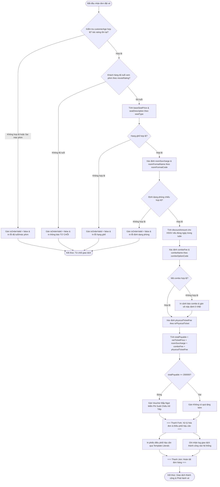

# BÁO CÁO BÀI TẬP: XÂY DỰNG HỆ THỐNG PHÂN PHỐI VÉ VÀ ĐIỀU PHỐI HẬU CẦN PHÒNG CHIẾU PHIM

> 👤 **Học viên:** Hoàng Công Dũng | **Mã SV:** PTIT-HCM-009
> 🏫 **Môn học:** it103b-rl-HoangCongDung

---

## 📊 Sơ đồ thiết kế hệ thống (Activity Diagram)

> 💡 *Sơ đồ dưới đây được render tự động trực tiếp trên GitHub bằng Mermaid. Bạn cũng có thể tải file **`bt3.drawio`** trong repository này để mở và chỉnh sửa trực tiếp trên [Draw.io (diagrams.net)](https://app.diagrams.net).* 

---

## 1. Mục tiêu và Bối cảnh bài toán

Hệ thống phân phối vé và quản lý hậu cần phòng chiếu phim đóng vai trò kiểm soát toàn bộ luồng giao dịch từ khâu kiểm duyệt độ tuổi khán giả, phân loại ghế ngồi, thiết bị phòng chiếu (IMAX, 4DX), các gói bắp nước cho đến ấn phẩm vé cứng lưu niệm.

Bài tập đòi hỏi vận dụng thành thạo cấu trúc điều kiện rẽ nhánh (if-else, if-else if-else, switch-case, toán tử ba ngôi) trong JavaScript hiện đại (ES6+) mà không sử dụng vòng lảng hay mảng, đảm bảo tính chặt chẽ về nghiệp vụ tài chính và kiểm duyệt văn hóa.

- Kiểm soát tuyệt đối độ tuổi khán giả theo quy định của Cục Điện ảnh trước khi cho phép giao dịch tiếp diễn.
- Áp dụng chính xác đơn giá ghế, phụ phí thiết bị phòng chiếu, chiết khấu học sinh sinh viên và quà tặng khuyến mãi.
- Tuân thủ quy chuẩn mã nguồn camelCase, sử dụng 100% let/const, toán tử nghiêm ngặt === và Template Literals.

## 2. Phân tích Quy tắc Nghiệp vụ và Bẫy Dữ liệu

Quá trình xử lý hóa đơn được thiết kế theo mô hình tuần tự khắt khe nhằm chặn đứng mọi sai sót từ khâu đầu vào đến khâu thanh toán cuối cùng.

Hệ thống áp dụng cờ kiểm soát 'isOrderValid' làm trọng tâm. Bất kỳ vi phạm nào về độ tuổi, định dạng phim, hạng ghế hay phòng chiếu đều lập tức bật cờ thành false, ngăn chặn việc phát sinh chi phí sai lệch.

- Quy tắc độ tuổi: Khán giả phải vượt qua ngưỡng tuổi tương ứng của mác phim ('P', 'T13', 'T16', 'T18') và thỏa mãn điều kiện số nguyên dương hợp lệ (!isNaN).
- Chính sách ưu đãi HSSV: Chỉ giảm 20% trên đơn giá ghế cơ sở 'baseSeatPrice' khi khách hàng là học sinh/sinh viên và suất chiếu rơi vào các ngày trong tuần (Thứ 2 đến Thứ 6).
- Khuyến mãi hậu cần: Hóa đơn tổng thanh toán từ 200.000 VNĐ trở lên tự động nhận voucher bắp ngọt cho suất chiếu kế tiếp.

## 3. Bảng đặc tả chi tiết thuật toán xử lý

Bảng tổng hợp các bước thực thi thuật toán phân phối vé và điều phối hậu cần trong tệp mã nguồn 'ticket_logistics_distribution.js':

| Bước | Nghiệp vụ thực hiện | Cấu trúc lập trình sử dụng | Ý nghĩa kiểm soát |
| --- | --- | --- | --- |
| 1 | Kiểm tra tính hợp lệ dữ liệu tuổi và mác phim | if / else kết hợp !isNaN | Chặn dữ liệu rác, đảm bảo đúng quy định pháp lý |
| 2 | Xác định đơn giá cơ sở và mô tả hạng ghế | if - else if - else | Phân loại chính xác ghế Tiêu chuẩn, VIP, Đôi |
| 3 | Xác định phụ phí thiết bị phòng chiếu | switch - case có break và default | Điều phối trang thiết bị 2D, 3D IMAX, 4DX an toàn |
| 4 | Áp dụng chính sách chiết khấu HSSV | Toán tử ba ngôi (? :) kết hợp logic && | Giảm trừ đúng 20% trên đơn giá vé cơ sở vào ngày thường |
| 5 | Xác định chi phí gói bắp nước hậu cần | switch - case có default cảnh báo | Cung cấp các gói Solo Box, Couple Box hoặc không lấy |
| 6 | Xác định phụ phí ấn phẩm vé cứng lưu niệm | Toán tử điều kiện ba ngôi (? :) | Cộng đúng 5000 VNĐ nếu khách hàng yêu cầu in vé cứng |
| 7 | Tổng hợp hóa đơn và phần thưởng khuyến mãi | Phép tính cộng số học và toán tử ba ngôi | Tính tổng 'totalPayable' và cấp voucher khi đạt mốc >= 200k |
| 8 | Xuất phiếu điều phối hậu cần hoàn chỉnh | Template Literals và console.log | In biểu mẫu hóa đơn chuẩn khi 'isOrderValid === true' |

## 4. Hướng dẫn thực thi mã nguồn và kiểm tra kết quả

Mã nguồn được viết hoàn toàn bằng JavaScript thuần túy theo chuẩn ES6+, không phụ thuộc thư viện ngoài.

Để chạy chương trình, sinh viên có thể mở tệp 'ticket_logistics_distribution.js' trực tiếp trong trình duyệt web qua F12 Console hoặc nhúng vào tệp 'index.html'.

---

## 📁 Danh sách tệp tin nộp bài trong Repository
- 📝 `bt3.docx`: Báo cáo tài liệu phân tích nghiệp vụ hoàn chỉnh.
- 🎨 `bt3.drawio`: File thiết kế sơ đồ chuẩn theo quy định đề bài (mở trực tiếp bằng [Draw.io](https://app.diagrams.net) hoặc Lucidchart).
- 💻 `ticket_logistics_distribution.js`: Mã nguồn chương trình.
